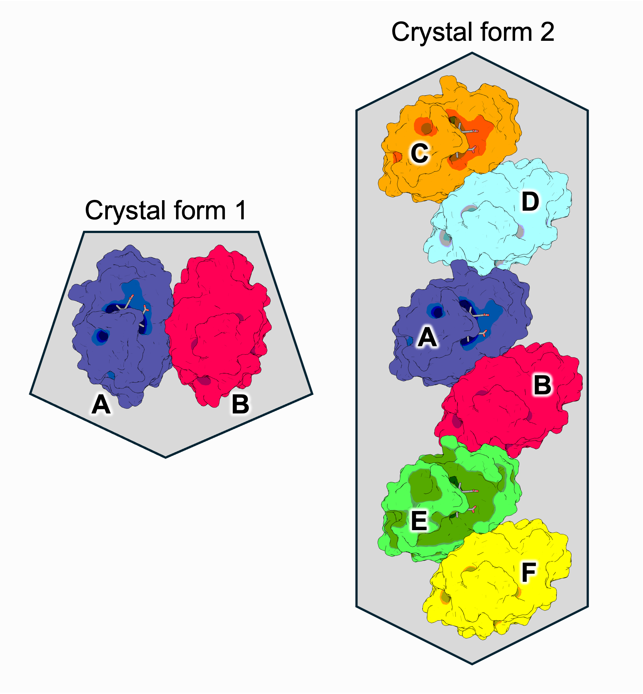

# assemblies.yaml Configuration and Keywords

This page describes the keywords available in the XChem Align `assemblies.yaml` file.

The assemblies file is validated against the built-in XChem Align assemblies schema. The schema defines the structure and permitted keywords, while some additional requirements are enforced by the XChem Align runtime.

The examples on this page are taken from the [assemblies YAML examples](USER-GUIDE.md#22-the-assemblies-yaml) in the User Guide, where each one is illustrated with a diagram.

The current assemblies keyword hierarchy is as follows:
```
assemblies.yaml
│
├── assemblies
│   └── <assembly name>
│       ├── reference
│       ├── biomol
│       └── chains
│
└── crystalforms
    └── <crystalform name>
        ├── reference
        └── assemblies
            └── <crystalform assembly name>
                ├── assembly
                └── chains

```

> **Note:** Items shown in angle brackets (for example `<assembly name>`) are user-defined names rather than fixed keywords. They can be any name that follows the naming rules described below.

The file must contain exactly two sections, `assemblies` and `crystalforms`. Both are required and no other sections are allowed.

All keywords below are required and none have default values.

Under `assemblies` **each assembly** contains:

| Keyword     | Type   | Description                                              |
| ----------- | ------ | -------------------------------------------------------- |
| `reference` | string | The dataset used as the reference structure.             |
| `biomol`    | string | The chain IDs used to label the biological assembly.     |
| `chains`    | string | The matching chains in the reference structure.          |

Under `crystalforms` **each crystal form** contains:

| Keyword      | Type   | Description                                                   |
| ------------ | ------ | ------------------------------------------------------------- |
| `reference`  | string | The dataset whose space group defines the crystal form.       |
| `assemblies` | object | The copies of each assembly found in the crystal form.        |

**Each entry** in a crystal form's `assemblies` contains:

| Keyword    | Type   | Description                                                      |
| ---------- | ------ | ---------------------------------------------------------------- |
| `assembly` | string | The name of an assembly defined in the `assemblies` section.     |
| `chains`   | string | The chains in this crystal form that make up this copy.          |

---

## User-defined names

Assembly names, crystal form names and crystal form assembly names are chosen by the user.

Using [Example 1](USER-GUIDE.md#221-example-1) from the User Guide:

```yaml
assemblies:
    monomer:                # assembly name
        ...
crystalforms:
    crystalform_1:          # crystal form name
        ...
        assemblies:
            assembly_1:     # crystal form assembly name
                ...
```

**Restrictions**

Each name must:

* contain between 1 and 80 characters;
* contain only letters, numbers, `-`, `_` and `.`.

Each name must be unique within its section. For example, `crystalform_1` cannot be used twice in the `crystalforms` section.

Descriptive names can make the file easier to read. For example, [Example 4](USER-GUIDE.md#224-example-4) uses `dimer_inhibited_assembly_C_D_A` to show which chains the entry contains.

---

## Chain notation

The `biomol` and `chains` keywords describe chains as comma-separated lists.

Using [Example 2](USER-GUIDE.md#222-example-2):

```yaml
chains: A,B,C
```

**Usage:**

* Each chain is identified by its chain ID in the reference PDB file, for example `A`, `B` or `C`.
* Spaces after commas are ignored, so `A,B,C` and `A, B, C` are equivalent.
* A chain may optionally be followed by a symmetry operator in brackets, for example `A(-x,y,-z)`. This describes a copy of the chain generated by applying that symmetry operation. It is needed when part of the assembly is a symmetry mate rather than a chain in the asymmetric unit.
* If no symmetry operator is given, the identity operator `x,y,z` is used. All of the User Guide examples use this default.

For example, if the `dimer` reference structure `model_4` from [Example 4](USER-GUIDE.md#224-example-4) only contained chain `A`, with the second half of the dimer generated by symmetry, the assembly could be written as:

```yaml
chains: A, A(-x,y,-z)
```

**Restrictions**

Chain IDs must be made of upper-case letters (`A`–`Z`). Lower-case letters and numbers are not recognised as chain IDs.

---

## `assemblies`

Defines the **biological assemblies** present in the data being aligned.

Using [Example 4](USER-GUIDE.md#224-example-4):

```yaml
assemblies:
    dimer:
        reference: model_4
        biomol: A,B
        chains: A,B
    dimer_inhibited:
        reference: model_5
        biomol: A,B,C
        chains: A,B,C
```

**Type:**

`object`

**Required:**

Yes.

At least one assembly must be defined.

Each assembly has:

* `reference`
* `biomol`
* `chains`

> **Note:** The order of assemblies in the file sets their priority during alignment. The first assembly listed, and the first chain in its `biomol`, are used as the overall alignment reference. Other assemblies are aligned relative to the highest-priority assembly they share a chain with.
>
>In the example above, `dimer` is listed first, so it is the overall reference. `dimer_inhibited` shares chain `A` with `dimer`, so it is aligned relative to `dimer`.
>
>You should therefore list the most important (or most common) assembly first.

---

### `assemblies.reference`

The dataset used as the reference structure for this assembly.

Using [Example 1](USER-GUIDE.md#221-example-1):

```yaml
assemblies:
    monomer:
        reference: model_1
```

**Type:**

`string`

**Required:**

Yes.

**Usage:**

The value must be the name of a crystal that is being processed by XChem Align. If it is not, the collator reports an error.

To make sure the reference dataset is always included, regardless of its SoakDB status, list it in `ref_datasets` in `config.yaml`:

```yaml
ref_datasets:
  - model_1
```

---

### `assemblies.biomol`

The chain IDs used to label the chains of the biological assembly.

Using [Example 2](USER-GUIDE.md#222-example-2):

```yaml
assemblies:
    trimer:
        reference: model_3
        biomol: A,B,C
        chains: A,B,C
```

**Type:**

`string`

**Required:**

Yes.

**Usage:**

These are the names given to the chains of the assembly in the aligned output. They are paired, in order, with the entries in `chains`.

In the example above:

| Biological chain (`biomol`) | Taken from `model_3` (`chains`) |
| --------------------------- | ------------------------------- |
| `A`                         | chain `A`                       |
| `B`                         | chain `B`                       |
| `C`                         | chain `C`                       |

`biomol` and `chains` should contain the same number of entries.

---

### `assemblies.chains`

The chains in the reference structure that make up the biological assembly.

Using [Example 4](USER-GUIDE.md#224-example-4):

```yaml
assemblies:
    dimer_inhibited:
        reference: model_5
        biomol: A,B,C
        chains: A,B,C
```

**Type:**

`string`

**Required:**

Yes.

**Usage:**

Each entry is a chain ID from the reference structure, optionally followed by a symmetry operator (see [Chain notation](#chain-notation)).

Here, `dimer_inhibited` is made of chains `A`, `B` and `C` of `model_5`.

---

## `crystalforms`

Defines the **crystal forms** present in the data, and which assemblies occur in each one.

Using [Example 1](USER-GUIDE.md#221-example-1):

```yaml
crystalforms:
    crystalform_1:
        reference: model_1
        assemblies:
            assembly_1:
                assembly: monomer
                chains: A
    crystalform_2:
        reference: model_2
        assemblies:
            assembly_1:
                assembly: monomer
                chains: A
```

**Type:**

`object`

**Required:**

Yes.

At least one crystal form must be defined.

Each crystal form has:

* `reference`
* `assemblies`

**How datasets are assigned to crystal forms**

XChem Align assigns each dataset to a crystal form automatically. A dataset is matched to a crystal form when:

* it has the same space group as the crystal form's `reference`;
* it contains the same set of protein chains as those listed across the crystal form's `assemblies`;
* its chains align reasonably well with the reference.

In the example above, a dataset in the same space group as `model_2`, containing only chain `A`, would be assigned to `crystalform_2`.

Where more than one crystal form matches, the closest one is chosen. If no crystal form matches, the aligner reports an error for that dataset.

Every crystal form present in your data should therefore be described in this section.

---

### `crystalforms.reference`

The dataset used as the reference structure for this crystal form.

Using [Example 1](USER-GUIDE.md#221-example-1):

```yaml
crystalforms:
    crystalform_2:
        reference: model_2
```

**Type:**

`string`

**Required:**

Yes.

**Restrictions**

The value must contain between 1 and 80 characters.

**Usage:**

The value must be the name of a crystal that is being processed by XChem Align. If it is not, the collator reports an error.

The space group, unit cell and chains of this structure define the crystal form. Here, `crystalform_2` is defined by the space group of `model_2`.

The crystal form reference does not need to be the same as the assembly reference. In Example 1, the `monomer` assembly uses `model_1`, while `crystalform_2` uses `model_2`.

To make sure the reference dataset is always included, regardless of its SoakDB status, list it in `ref_datasets` in `config.yaml`.

---

### `crystalforms.assemblies`

Lists the copies of each biological assembly found in the crystal form.

Using [Example 3](USER-GUIDE.md#223-example-3):

```yaml
crystalforms:
    crystalform_2:
        reference: model_2
        assemblies:
            assembly_1:
                assembly: monomer
                chains: A
            assembly_2:
                assembly: monomer
                chains: B
```

**Type:**

`object`

**Required:**

Yes.

At least one entry must be provided.

Each entry is given a user-defined name (for example `assembly_1`) and has:

* `assembly`
* `chains`

If the asymmetric unit contains more than one copy of an assembly, add one entry per copy. The same `assembly` can be used by several entries.

In the example above, `model_2` contains two copies of the `monomer`, in chains `A` and `B`. Only one `monomer` assembly is needed in the `assemblies` section; XChem Align maps both chains onto chain `A` of the `monomer` reference.

A crystal form can also contain different assemblies. In [Example 4](USER-GUIDE.md#224-example-4), `crystalform_2` contains one `dimer` and two copies of `dimer_inhibited`.

---

### `crystalforms.assemblies.assembly`

The name of the biological assembly that this entry is a copy of.

Using [Example 4](USER-GUIDE.md#224-example-4):

```yaml
crystalforms:
    crystalform_2:
        reference: model_5
        assemblies:
            dimer_assembly_A_B:
                assembly: dimer
                chains: A,B
            dimer_inhibited_assembly_C_D_A:
                assembly: dimer_inhibited
                chains: C,D,A
```

**Type:**

`string`

**Required:**

Yes.

**Restrictions**

The value must contain between 1 and 80 characters.

**Usage:**

The value must match the name of an assembly defined in the top-level `assemblies` section. Here, `dimer` and `dimer_inhibited` are both defined in `assemblies`.

If it does not match, validation fails with an error such as:

```text
The assembly 'dimer_inhibited' in crystalform 'crystalform_2->dimer_inhibited_assembly_C_D_A' is not an assembly in the file
```

---

### `crystalforms.assemblies.chains`

The chains in this crystal form that make up this copy of the assembly.

Using [Example 4](USER-GUIDE.md#224-example-4):

```yaml
assemblies:
    dimer_inhibited:
        reference: model_5
        biomol: A,B,C
        chains: A,B,C
crystalforms:
    crystalform_2:
        reference: model_5
        assemblies:
            dimer_inhibited_assembly_C_D_A:
                assembly: dimer_inhibited
                chains: C,D,A
```

**Type:**

`string`

**Required:**

Yes.

**Restrictions**

The value must contain between 1 and 80 characters.

**Usage:**

Uses the same [chain notation](#chain-notation) as `assemblies.chains`.

The chains are paired, in order, with the `biomol` chains of the referenced assembly. In the example above:

| Crystal form chain (`chains`) | Biological chain in `dimer_inhibited` (`biomol`) |
| ----------------------------- | ------------------------------------------------ |
| `C`                           | `A`                                              |
| `D`                           | `B`                                              |
| `A`                           | `C`                                              |

So dimer `CD` is mapped onto the dimer of `dimer_inhibited`, and chain `A` is mapped onto the inhibiting chain.

The order of the chains is therefore important.

---

## Updating assemblies.yaml between versions

When a new upload version is created, the previous `assemblies.yaml` is carried forward.

Assemblies and crystal forms from earlier versions are kept. New entries can be added, but an entry that reuses an existing name is ignored and the original definition is kept.

For example, if `crystalform_1` has already been processed, you can add a new `crystalform_3`, but changing the definition of `crystalform_1` will have no effect.

To change an existing definition, use a new name for the assembly or crystal form.

---

## Assemblies example

The complete `assemblies.yaml` from [Example 4](USER-GUIDE.md#224-example-4) brings these keywords together:

```yaml
assemblies:
    dimer:
        reference: model_4
        biomol: A,B
        chains: A,B
    dimer_inhibited:
        reference: model_5
        biomol: A,B,C
        chains: A,B,C
crystalforms:
    crystalform_1:
        reference: model_4
        assemblies:
            dimer_assembly_A_B:
                assembly: dimer
                chains: A,B
    crystalform_2:
        reference: model_5
        assemblies:
            dimer_assembly_A_B:
                assembly: dimer
                chains: A,B
            dimer_inhibited_assembly_C_D_A:
                assembly: dimer_inhibited
                chains: C,D,A
            dimer_inhibited_assembly_E_F_B:
                assembly: dimer_inhibited
                chains: E,F,B
```

This describes:

* a `dimer` assembly, made of chains `A` and `B` of `model_4`
* a `dimer_inhibited` assembly, made of chains `A`, `B` and `C` of `model_5`
* `crystalform_1`, defined by `model_4`, containing one `dimer` in chains `A` and `B`
* `crystalform_2`, defined by `model_5`, containing:
  * one `dimer` in chains `A` and `B`;
  * one `dimer_inhibited`, where dimer `CD` is inhibited by chain `A`
  * one `dimer_inhibited`, where dimer `EF` is inhibited by chain `B`

  
